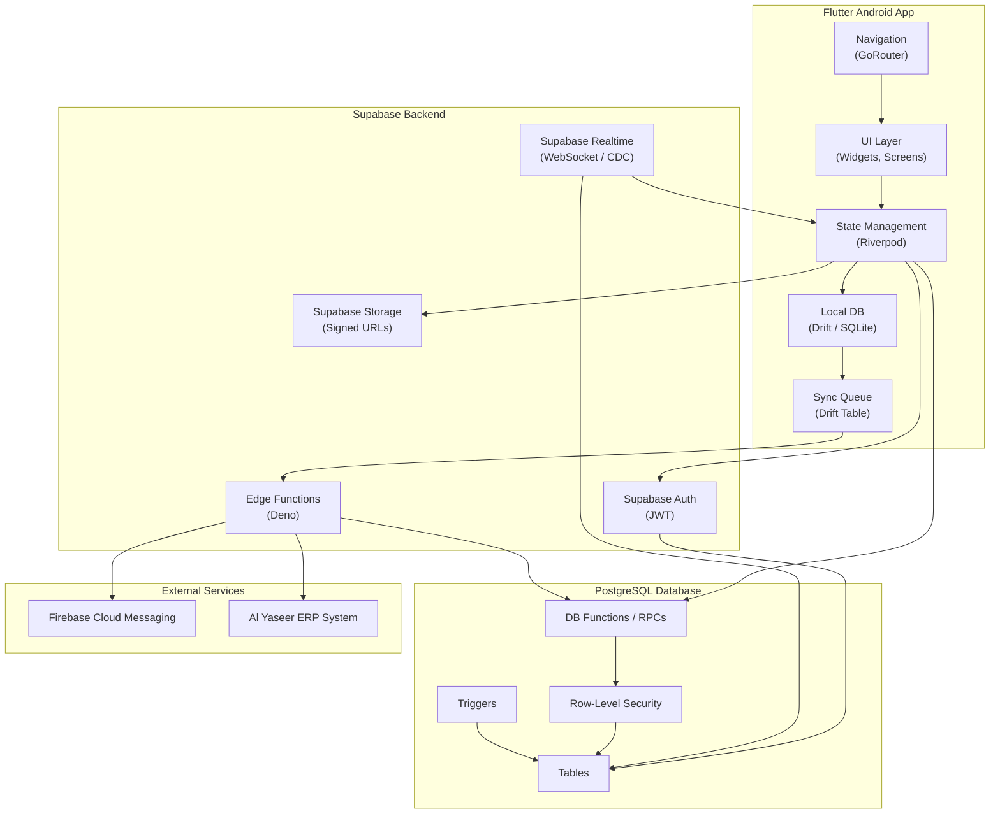
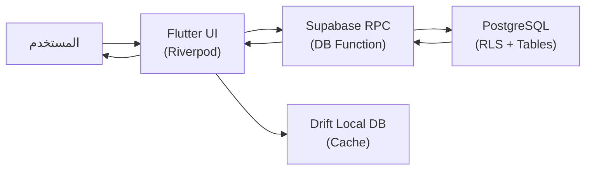
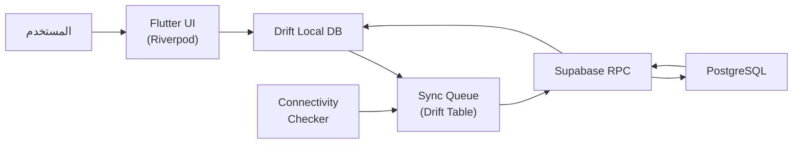
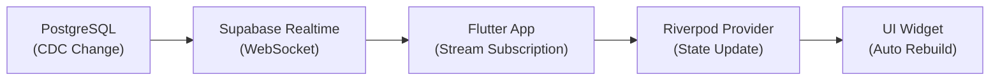
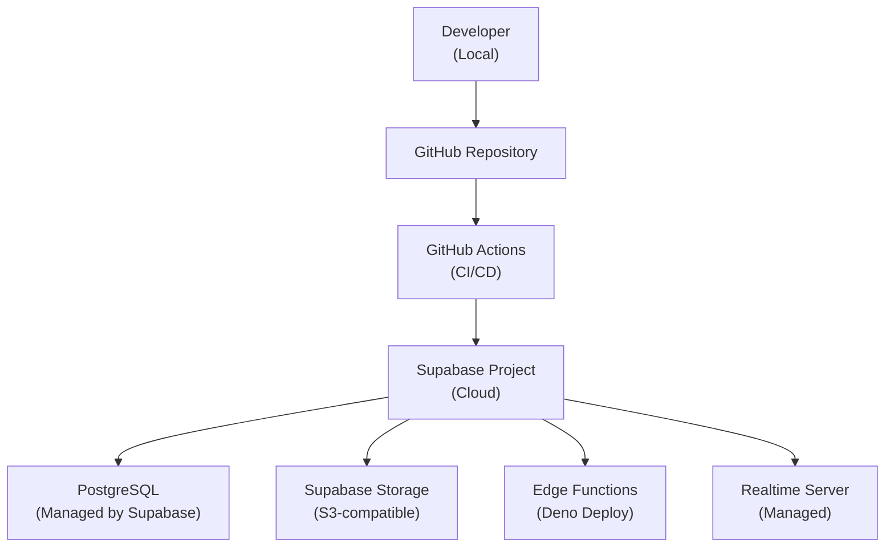
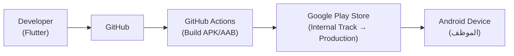

# 01 — System Architecture Overview

> [!NOTE]
> هذا الملف يوثّق المعمارية الكاملة لنظام WMS (Warehouse Management System). الشرح بالعربي، والكود والأسماء التقنية بالإنجليزي.

---

## 1. High-Level Architecture

يعتمد النظام على معمارية متعددة الطبقات (Layered Architecture) تضمن الفصل الواضح بين المسؤوليات، وتدعم العمل أوفلاين بشكل كامل.

### الطبقات الرئيسية

| الطبقة | التقنية | المسؤولية |
|--------|---------|-----------|
| **Presentation Layer** | Flutter (Android) | واجهة المستخدم، إدارة الحالة عبر Riverpod، التنقل عبر GoRouter |
| **Local Data Layer** | Drift / SQLite | قاعدة بيانات محلية، Offline Cache، Sync Queue |
| **Backend Layer** | Supabase | Auth، Realtime، Storage، Edge Functions |
| **Data Layer** | PostgreSQL | قاعدة البيانات الرئيسية، RLS، Functions، Triggers |
| **Notification Layer** | Firebase Cloud Messaging | إشعارات Push للموظفين |
| **Integration Layer** | Al Yaseer System | استيراد/تصدير البيانات مع النظام الخارجي |

### وصف الطبقات

#### 1.1 Flutter Android App — Presentation Layer
- التطبيق مكتوب بالكامل بـ **Flutter** ويستهدف **Android** حصراً.
- إدارة الحالة عبر **Riverpod** (AsyncNotifier / StateNotifier).
- التنقل بين الشاشات عبر **GoRouter** مع دعم Deep Links.
- التواصل مع Supabase عبر `supabase_flutter` SDK.
- التخزين المحلي والعمل أوفلاين عبر **Drift** (ORM فوق SQLite).

#### 1.2 Supabase — Backend Layer
- **Auth**: إدارة المصادقة (Email/Password)، JWT tokens، Refresh Tokens.
- **Realtime**: بث تغييرات قاعدة البيانات لحظياً عبر WebSocket (Postgres CDC).
- **Storage**: تخزين الملفات (صور المستودع، المرفقات) مع Signed URLs.
- **Edge Functions**: منطق الأعمال المعقد (Deno runtime)، Integration مع Al Yaseer.

#### 1.3 PostgreSQL — Data Layer
- قاعدة البيانات الأساسية مُدارة بالكامل من Supabase.
- **RLS (Row-Level Security)**: كل جدول محمي بسياسات RLS.
- **Database Functions**: منطق الأعمال الحرج داخل PostgreSQL (RPCs).
- **Triggers**: أتمتة العمليات (updated_at، audit logs، sync events).

#### 1.4 Drift / SQLite — Local Layer
- قاعدة بيانات محلية على جهاز المستخدم لدعم العمل أوفلاين.
- **Offline Cache**: نسخة محلية من البيانات المهمة.
- **Sync Queue**: قائمة انتظار للعمليات التي تنتظر الرفع لـ Supabase.

#### 1.5 Firebase Cloud Messaging — Notification Layer
- إرسال إشعارات Push للموظفين عبر FCM.
- Edge Functions تُرسل الإشعارات عند وقوع أحداث معينة (مهمة جديدة، تحديث حالة).

#### 1.6 Al Yaseer Integration Layer
- نظام ERP خارجي يمتلكه العميل.
- التكامل عبر **Supabase Edge Functions** (HTTP REST) أو Scheduled Jobs.
- يُعدّ هذا الطبقة حدًا واضحاً: النظام لا يستدعي Al Yaseer مباشرة من Flutter.

---

## 2. Component Architecture Diagram

المخطط التالي يوضح جميع المكونات وعلاقاتها:



---

## 3. Data Flow Architecture

### 3.1 Online Mode — الحالة الاعتيادية

عندما يكون الجهاز متصلاً بالإنترنت، تتدفق البيانات مباشرةً:



**الخطوات:**
1. المستخدم يُنفّذ إجراءً (مثل: تسليم طلب).
2. Riverpod Provider يستدعي Supabase RPC (Database Function).
3. PostgreSQL يُنفّذ الـ Function مع تطبيق RLS.
4. النتيجة ترجع لـ Flutter وتُخزَّن في Drift كـ Cache.
5. الواجهة تُحدَّث فوراً.

---

### 3.2 Offline Mode — العمل بدون إنترنت



**الخطوات:**
1. الجهاز غير متصل → Flutter يقرأ ويكتب على Drift مباشرة.
2. كل عملية (write) تُضاف كـ record في جدول `sync_queue` بـ **Idempotency Key**.
3. عند استعادة الاتصال، `ConnectivityChecker` يُطلق عملية المزامنة.
4. الـ Sync Worker يرفع العمليات المنتظرة بالترتيب لـ Supabase.
5. في حال التعارض (Conflict): **Server-Authoritative** — نسخة الخادم تفوز.

---

### 3.3 Realtime Mode — التحديثات اللحظية



**الخطوات:**
1. تغيير يحدث في PostgreSQL (INSERT / UPDATE / DELETE).
2. Supabase Realtime يبث التغيير عبر WebSocket.
3. Flutter يستقبل الحدث عبر `supabase.from('table').stream(...)`.
4. Riverpod Provider يُحدّث الحالة تلقائياً.
5. الـ UI يُعاد بناؤه (rebuild) بدون تدخل المستخدم.

---

## 4. Security Architecture

> [!IMPORTANT]
> الأمان ليس ميزة إضافية — هو جزء أساسي من المعمارية. كل قرار هنا نهائي وغير قابل للتفاوض.

### 4.1 Row-Level Security (RLS)

- **كل جدول** في PostgreSQL يمتلك RLS مُفعّل.
- المستخدم يرى فقط البيانات التي تنتمي لـ `warehouse_id` الخاص به أو صلاحياته.
- السياسات تُكتب بـ SQL وتُختبر بمستخدمين حقيقيين.

```sql
-- مثال على سياسة RLS
CREATE POLICY "employee_own_tasks" ON tasks
  FOR SELECT
  USING (
    employee_id = auth.uid()
    OR EXISTS (
      SELECT 1 FROM employees
      WHERE id = auth.uid() AND role IN ('supervisor', 'manager')
        AND warehouse_id = tasks.warehouse_id
    )
  );
```

### 4.2 RBAC — Role-Based Access Control

- الأدوار محفوظة في جدول `employees` في PostgreSQL (ليس في JWT claims مباشرة).
- RLS تقرأ الدور من قاعدة البيانات لضمان دقة الصلاحيات في الوقت الفعلي.
- تغيير دور موظف يُطبَّق فوراً بدون الحاجة لإعادة تسجيل دخول.

### 4.3 لا Service Role Key في Flutter

> [!CAUTION]
> **Service Role Key** لا يُوضع أبداً داخل تطبيق Flutter. أي عملية تتطلبه تمر عبر **Edge Functions** فقط.

| المفتاح | المكان المسموح به |
|---------|------------------|
| `anon key` | Flutter App (آمن للعرض العام) |
| `service_role key` | Edge Functions فقط (server-side) |
| `JWT token` | Flutter (يُولَّد من Auth ويُرسَل مع كل طلب) |

### 4.4 Signed URLs للملفات

- ملفات Supabase Storage لا تكون `public` أبداً.
- كل رابط ملف هو **Signed URL** بصلاحية زمنية محدودة (مثلاً 1 ساعة).
- يُولَّد الـ Signed URL من Edge Function بعد التحقق من صلاحيات المستخدم.

---

## 5. Offline Architecture

> [!NOTE]
> دعم العمل أوفلاين ليس اختيارياً — المستودعات قد تكون في مناطق ضعيفة الإشارة.

### 5.1 Drift Local Database

- **Drift** هو ORM بـ Dart يعمل فوق SQLite.
- يُعرِّف Schema بـ Dart classes (type-safe).
- يدعم Migrations للترقيات المستقبلية.
- كل البيانات الأساسية (مهام، موظفون، مواقع) تُخزَّن محلياً كـ Cache.

### 5.2 Sync Queue

جدول `sync_queue` في Drift يحتوي على العمليات المنتظرة:

| الحقل | النوع | الوصف |
|-------|-------|--------|
| `id` | UUID | معرّف فريد للعملية |
| `idempotency_key` | TEXT | مفتاح لضمان عدم التكرار |
| `operation` | TEXT | `INSERT` / `UPDATE` / `DELETE` |
| `table_name` | TEXT | اسم الجدول المستهدف |
| `payload` | JSON | البيانات المُراد رفعها |
| `created_at` | TIMESTAMP | وقت إنشاء العملية |
| `status` | TEXT | `pending` / `syncing` / `done` / `failed` |
| `retry_count` | INTEGER | عدد محاولات الإعادة |

### 5.3 Idempotency Keys

- كل عملية تُنشأ بـ UUID فريد كـ `idempotency_key`.
- Supabase Edge Function تتحقق من المفتاح قبل تنفيذ العملية.
- إذا تكررت العملية (شبكة انقطعت أثناء الرفع)، يُتجاهَل التكرار.

### 5.4 Conflict Resolution: Server-Authoritative

> [!IMPORTANT]
> في حال وجود تعارض بين البيانات المحلية وبيانات الخادم، **نسخة الخادم تفوز دائماً**.

```
السبب: البيانات الحرجة (المخزون، الأوزان، الكميات) لا يمكن دمجها تلقائياً
بأمان. القرار المبني على أحدث نسخة على الخادم أضمن من أي منطق دمج معقد.
```

**آلية الحل:**
1. بعد كل Sync ناجح، يُحدَّث الـ local cache بالبيانات من الخادم.
2. أي تعارض يُسجَّل في `conflict_log` للمراجعة.
3. المستخدم يُبلَّغ إذا تغيّرت بيانات كان ينتظر إرسالها.

---

## 6. Technology Decisions & Justifications

| التقنية | الدور | سبب الاختيار |
|---------|-------|--------------|
| **Flutter** | Framework الرئيسي | Dart strongly-typed، أداء native، كود موحّد، دعم ممتاز لـ Android |
| **Riverpod** | State Management | Type-safe، testable، لا boilerplate، AsyncNotifier للعمليات الغير متزامنة |
| **GoRouter** | Navigation | دعم Deep Links، Declarative routing، متوافق مع Riverpod |
| **Drift** | Local ORM | Type-safe SQL، Migrations آمنة، reactive streams، دعم ممتاز لـ SQLite |
| **Supabase** | Backend-as-a-Service | PostgreSQL managed، Auth مدمج، Realtime، Storage، Edge Functions — كل شيء في مكان واحد |
| **PostgreSQL** | قاعدة البيانات | RLS على مستوى الصفوف، Functions، Triggers، Reliability عالية |
| **Supabase Auth** | المصادقة | JWT tokens، Refresh Tokens، متكامل مع RLS |
| **Supabase Realtime** | التحديثات اللحظية | Postgres CDC، WebSocket managed، لا حاجة لـ polling |
| **Supabase Storage** | تخزين الملفات | Signed URLs، RLS على الملفات، متكامل مع Auth |
| **Edge Functions** | Server-side Logic | Deno runtime، تنفيذ آمن للعمليات الحساسة، Integration مع Al Yaseer |
| **Firebase Cloud Messaging** | Push Notifications | المعيار الصناعي لـ Android، موثوق، مجاني للاستخدام الأساسي |
| **GitHub Actions** | CI/CD | مجاني، متكامل مع GitHub، بناء APK تلقائي |

---

## 7. Deployment Architecture

### 7.1 Backend — Supabase Cloud



**تفاصيل البنية:**
- **Supabase Project**: مشروع واحد (يمكن إضافة `staging` لاحقاً).
- **Database Migrations**: تُدار عبر `supabase db push` في CI/CD pipeline.
- **Edge Functions**: تُنشر عبر `supabase functions deploy`.
- **Environment Variables**: تُدار عبر Supabase Dashboard Secrets.

### 7.2 Mobile App — Google Play Store



**مراحل الإصدار:**
1. **Internal Testing**: للمطوّر والمختبرين الأوليين.
2. **Closed Testing (Alpha)**: لفريق العميل الداخلي.
3. **Production**: الإصدار الرسمي للموظفين.

### 7.3 بيئات النشر

| البيئة | Supabase Project | Flutter Build Flavor | الغرض |
|--------|-----------------|---------------------|--------|
| **Development** | Local Supabase CLI | `dev` | التطوير المحلي |
| **Staging** | Supabase Cloud (staging) | `staging` | الاختبار قبل الإطلاق |
| **Production** | Supabase Cloud (prod) | `prod` | البيئة الحية |

> [!TIP]
> في المرحلة الأولى يمكن الاكتفاء بـ `development` و `production` فقط، وإضافة `staging` عند الحاجة.

---

## ملاحظات المعمارية النهائية

> [!WARNING]
> القرارات المعمارية التالية **نهائية** في Phase 0 ولا يجوز تغييرها بدون مراجعة كاملة للمستندات:
> - لا `service_role key` في Flutter.
> - RLS على كل الجداول بدون استثناء.
> - Server-Authoritative كآلية وحيدة لحل التعارضات.
> - كل Integration مع Al Yaseer يمر عبر Edge Functions فقط.

---

*آخر تحديث: النسخة الأولى — Phase 0*
