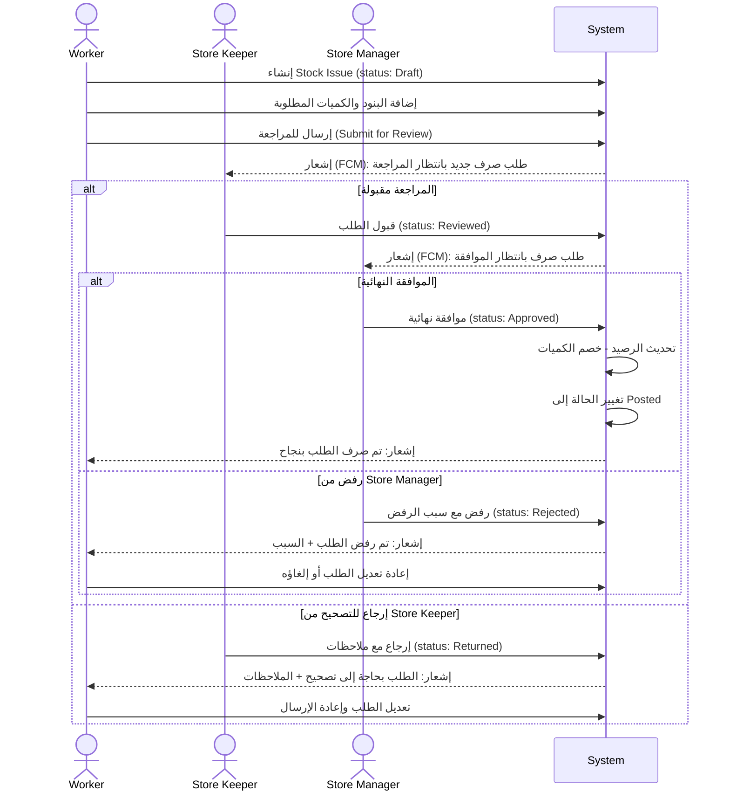
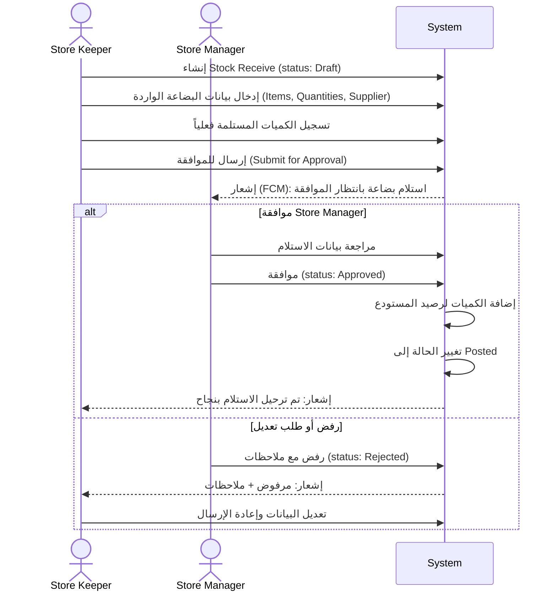
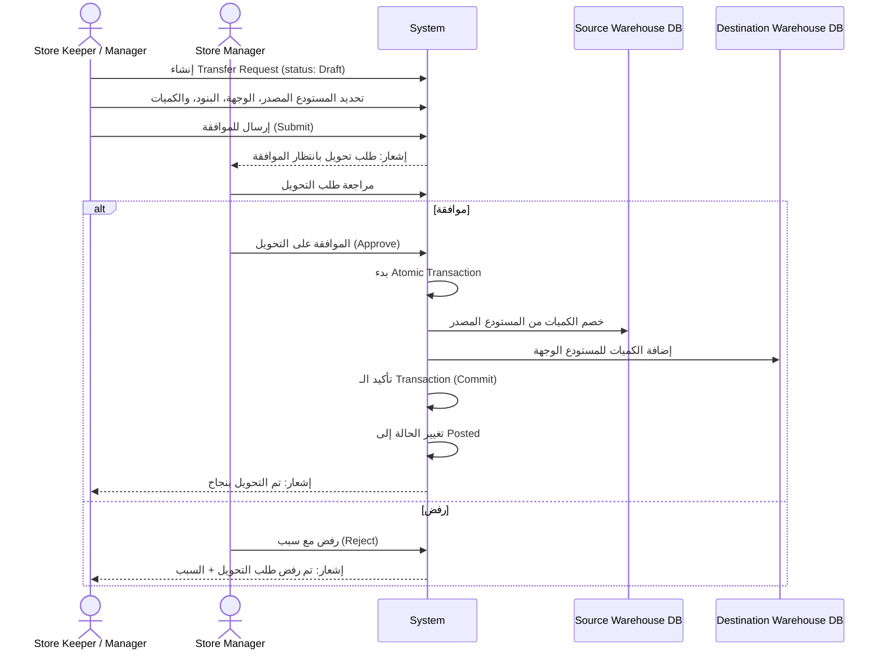
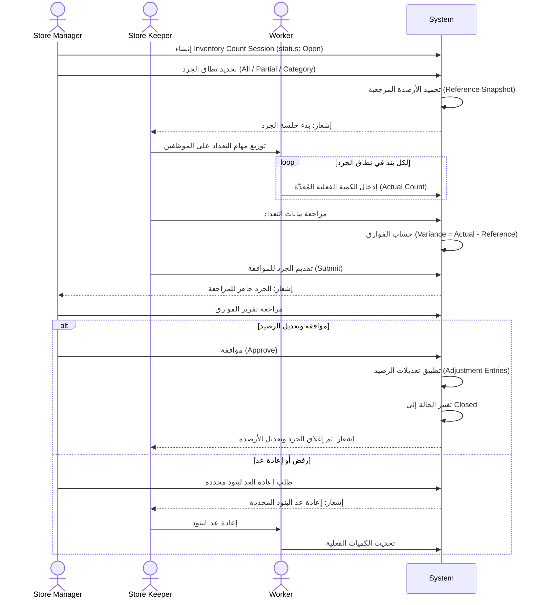
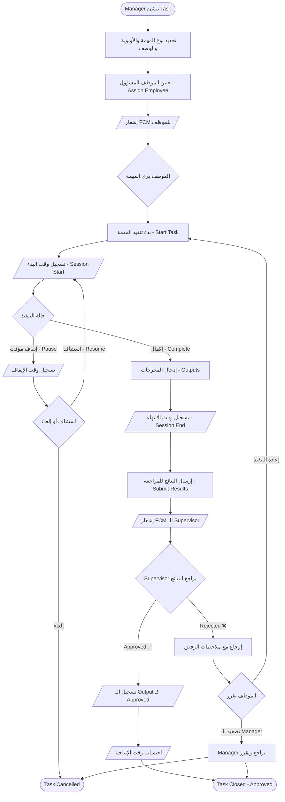
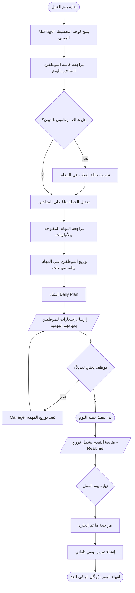
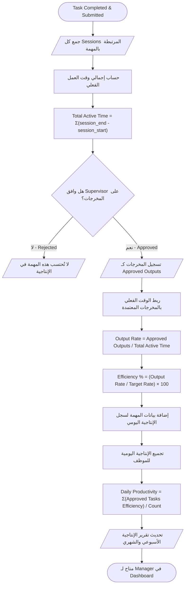
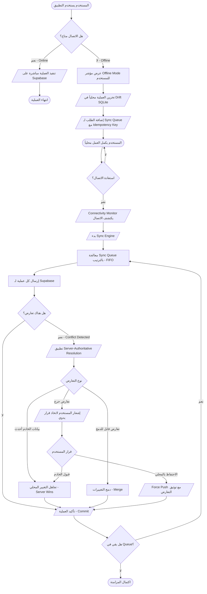

# 02 — Business Workflow Diagrams

> [!NOTE]
> هذا المستند يصف جميع سير العمل الرئيسية (Business Workflows) لنظام إدارة المستودعات (WMS).  
> كل workflow يحتوي على مخطط Mermaid، ووصف نصي تفصيلي، وتوضيح الأدوار المسؤولة عن كل خطوة.  
> **الشرح بالعربي — الأسماء والمصطلحات التقنية بالإنجليزي.**

---

## 1. Stock Issue Workflow — طلب صرف مخزون

### الوصف
يُستخدم هذا الـ workflow لتسجيل وصرف كميات من المخزون بناءً على احتياجات العمل. يمر الطلب بمراحل موافقة متعددة قبل أن يُنفَّذ ويُحدَّث الرصيد.

### المسؤوليات (Roles)

| الخطوة | المسؤول |
|--------|---------|
| إنشاء الطلب (Draft) | Worker / Requester |
| مراجعة الكميات والبنود | Store Keeper |
| الموافقة النهائية | Store Manager |
| تحديث الرصيد (Posting) | System (Automatic) |

### المخطط



### خطوات الـ Workflow بالتفصيل

1. **Draft — إنشاء الطلب** *(Worker)*  
   يقوم الموظف بإنشاء طلب صرف جديد، ويضيف البنود (Items) والكميات المطلوبة وتحديد المستودع المصدر.

2. **Submit for Review — الإرسال للمراجعة** *(Worker)*  
   بعد التأكد من صحة البيانات، يُرسل الطلب إلى Store Keeper للمراجعة. تُرسَل إشعارات FCM تلقائياً.

3. **Review — المراجعة** *(Store Keeper)*  
   يتحقق Store Keeper من توفر الكميات في المستودع ومن صحة البنود المطلوبة.
   - **قبول:** ينقل الحالة إلى `Reviewed` ويُحيلها لـ Store Manager.
   - **إرجاع:** يُعيد الطلب للموظف مع ملاحظات للتصحيح (status: `Returned`).

4. **Approval — الموافقة النهائية** *(Store Manager)*  
   يراجع Store Manager الطلب ويتخذ قراراً نهائياً:
   - **موافقة:** status → `Approved` ثم يقوم النظام بالـ Posting.
   - **رفض:** status → `Rejected` مع سبب واضح.

5. **Post — تحديث الرصيد** *(System)*  
   عند الموافقة، يُنفِّذ النظام تلقائياً خصم الكميات من رصيد المستودع ويُغلق الطلب بحالة `Posted`.

---

## 2. Stock Receive Workflow — استلام بضاعة

### الوصف
يُسجَّل هذا الـ workflow عند وصول بضاعة جديدة إلى المستودع، من إنشاء إشعار الاستلام حتى إضافة الكميات للرصيد بعد التحقق والموافقة.

### المسؤوليات (Roles)

| الخطوة | المسؤول |
|--------|---------|
| إنشاء إشعار الاستلام | Store Keeper / Worker |
| التحقق من البضاعة الواردة | Store Keeper |
| الموافقة على الاستلام | Store Manager |
| تحديث الرصيد | System (Automatic) |

### المخطط



### خطوات الـ Workflow بالتفصيل

1. **Draft — إنشاء إشعار الاستلام** *(Store Keeper)*  
   عند وصول الشحنة، يُنشئ Store Keeper سجل استلام جديد ويُدخل بيانات المورد والبنود الواردة.

2. **Record Received Quantities — تسجيل الكميات الفعلية** *(Store Keeper)*  
   يُسجَّل الفارق (إن وجد) بين الكمية المُرسَلة والكمية المستلمة فعلياً.

3. **Submit for Approval — الإرسال للموافقة** *(Store Keeper)*  
   يُرسَل السجل إلى Store Manager لإقراره.

4. **Approval — الموافقة** *(Store Manager)*  
   يراجع Store Manager البيانات ويوافق أو يطلب التعديل.

5. **Post — تحديث الرصيد** *(System)*  
   عند الموافقة، يُضيف النظام تلقائياً الكميات المستلمة إلى رصيد المستودع ويُغلق السجل بحالة `Posted`.

---

## 3. Warehouse Transfer Workflow — تحويل بين مستودعات

### الوصف
نقل كميات من مواد بشكل atomic من مستودع مصدر (Source Warehouse) إلى مستودع وجهة (Destination Warehouse)، مع الحفاظ على سلامة الرصيد في كلا المستودعين.

### المسؤوليات (Roles)

| الخطوة | المسؤول |
|--------|---------|
| إنشاء طلب التحويل | Store Keeper / Manager |
| موافقة على التحويل | Store Manager |
| خصم من المصدر + إضافة للوجهة | System (Atomic Transaction) |

### المخطط



### خطوات الـ Workflow بالتفصيل

1. **Draft — إنشاء طلب التحويل** *(Store Keeper / Manager)*  
   تحديد المستودع المصدر والوجهة، والبنود والكميات المراد تحويلها.

2. **Submit — الإرسال للموافقة** *(Initiator)*  
   إرسال الطلب لـ Store Manager مع إشعار تلقائي.

3. **Approval — الموافقة** *(Store Manager)*  
   مراجعة توفر الكميات في المصدر وملاءمة التحويل.

4. **Atomic Transfer — التحويل الفعلي** *(System)*  
   يُنفَّذ التحويل كـ Database Transaction واحدة (خصم + إضافة). إذا فشلت أي خطوة، تُلغى العملية كاملة (Rollback) لضمان سلامة البيانات.

5. **Post — الإغلاق** *(System)*  
   تُغلق العملية بحالة `Posted` ويُرسَل إشعار للمبادر.

---

## 4. Inventory Count Workflow — جرد المخزون

### الوصف
يُستخدم للتحقق الدوري من الأرصدة الفعلية في المستودع ومقارنتها بالأرصدة المسجلة في النظام، ثم تعديل الفارق بعد الموافقة.

### المسؤوليات (Roles)

| الخطوة | المسؤول |
|--------|---------|
| إنشاء جلسة الجرد | Store Manager |
| تعداد البنود فعلياً | Store Keeper / Worker |
| مراجعة الفوارق | Store Keeper |
| الموافقة وتعديل الرصيد | Store Manager + System |

### المخطط



### خطوات الـ Workflow بالتفصيل

1. **Open Session — فتح جلسة الجرد** *(Store Manager)*  
   يُحدِّد نطاق الجرد (كامل / جزئي / فئة معينة) ويأمر النظام بأخذ لقطة (Snapshot) للأرصدة الحالية كمرجع.

2. **Physical Count — التعداد الفعلي** *(Store Keeper / Worker)*  
   يقوم الموظفون بعد الوحدات الفعلية في المستودع وإدخال الكميات في النظام.

3. **Variance Calculation — حساب الفوارق** *(System)*  
   يقارن النظام تلقائياً الكميات الفعلية بالمرجعية ويُولِّد تقرير الفوارق.

4. **Submit & Approval — التقديم والموافقة** *(Store Keeper → Store Manager)*  
   يراجع Store Manager الفوارق ويقرر:
   - **الموافقة:** يُطبَّق تعديل الرصيد تلقائياً.
   - **إعادة العد:** يطلب إعادة عد بنود بعينها.

5. **Close — إغلاق الجرد** *(System)*  
   بعد الموافقة، تُطبَّق تعديلات الرصيد وتُغلق الجلسة بحالة `Closed`.

---

## 5. Task Assignment & Execution Workflow — تعيين وتنفيذ المهام

### الوصف
يصف هذا الـ workflow دورة حياة المهمة (Task) كاملة من إنشائها من قِبَل المدير حتى مراجعة نتائجها من قِبَل المشرف.

### المسؤوليات (Roles)

| الخطوة | المسؤول |
|--------|---------|
| إنشاء وتعيين المهمة | Manager |
| تلقي الإشعار وقبول المهمة | Employee |
| تنفيذ / إيقاف / استئناف | Employee |
| إرسال النتائج | Employee |
| المراجعة والموافقة | Supervisor |

### المخطط



### خطوات الـ Workflow بالتفصيل

1. **Create Task — إنشاء المهمة** *(Manager)*  
   يُنشئ المدير مهمة جديدة مع تحديد النوع، الأولوية، الوصف، والموعد المتوقع للانتهاء.

2. **Assign Employee — تعيين الموظف** *(Manager)*  
   اختيار الموظف المناسب بناءً على التوفر والمهارة.

3. **FCM Notification — الإشعار** *(System)*  
   يتلقى الموظف إشعاراً فورياً بالمهمة الجديدة المُعيَّنة له.

4. **Start Task — بدء التنفيذ** *(Employee)*  
   يضغط الموظف على "Start" ليبدأ النظام بتسجيل Session مع timestamp للبدء.

5. **Pause / Resume — الإيقاف والاستئناف** *(Employee)*  
   يمكن للموظف إيقاف المهمة مؤقتاً (مثلاً لاستراحة أو عمل طارئ) وإعادة استئنافها لاحقاً. يُسجِّل النظام كل Session بشكل منفصل.

6. **Complete & Submit — الإكمال والإرسال** *(Employee)*  
   عند الانتهاء، يُدخل الموظف المخرجات (Outputs) ويُرسل النتائج للمراجعة.

7. **Review — المراجعة** *(Supervisor)*  
   يراجع المشرف النتائج ويتخذ قراراً:
   - **Approved:** تُحتسب ضمن الإنتاجية.
   - **Rejected:** يُرجع للموظف مع ملاحظات.

---

## 6. Daily Workforce Planning Workflow — تخطيط القوى العاملة اليومي

### الوصف
في بداية كل يوم عمل، يقوم المدير بتوزيع الموظفين الحاضرين على المهام والمستودعات المختلفة.

### المسؤوليات (Roles)

| الخطوة | المسؤول |
|--------|---------|
| مراجعة الحضور والإتاحة | Manager |
| إنشاء خطة اليوم | Manager |
| توزيع المهام | Manager |
| تلقي التكليفات | Employees |

### المخطط



### خطوات الـ Workflow بالتفصيل

1. **مراجعة الحضور** *(Manager)*  
   يبدأ المدير بالاطلاع على قائمة الموظفين المتاحين في ذلك اليوم، مع مراعاة الغيابات والإجازات.

2. **مراجعة الأولويات** *(Manager)*  
   يستعرض المدير المهام المفتوحة والمتأخرة وفق الأولوية.

3. **التوزيع اليومي** *(Manager)*  
   يُعيِّن المدير كل موظف على مهام ومستودعات محددة بناءً على المهارة والتوفر.

4. **إشعار الموظفين** *(System)*  
   يتلقى كل موظف إشعاراً بمهامه ليوم العمل فور حفظ الخطة.

5. **المتابعة اللحظية** *(Manager / System)*  
   يتابع المدير تقدم الموظفين في الوقت الفعلي عبر لوحة التحكم (Dashboard) المدعومة بـ Supabase Realtime.

6. **التقرير اليومي** *(System)*  
   في نهاية اليوم، يُولِّد النظام تقريراً تلقائياً بما أُنجز وما لم يُنجز، ويُرحَّل الباقي لليوم التالي.

---

## 7. Employee Productivity Calculation Workflow — حساب إنتاجية الموظف

### الوصف
يصف هذا الـ workflow آلية حساب إنتاجية الموظف بشكل دقيق بناءً على الـ Sessions الفعلية والمخرجات (Outputs) الموافق عليها من المشرف.

### المسؤوليات (Roles)

| الخطوة | المسؤول |
|--------|---------|
| تسجيل Sessions | System (Auto on Task Start/Pause/Resume/End) |
| الموافقة على المخرجات | Supervisor |
| حساب الإنتاجية | System (Automatic) |
| مراجعة التقارير | Manager / Admin |

### المخطط



### صيغة الحساب

```
إجمالي وقت العمل الفعلي (Active Time):
  Total Active Time = Σ (session_end_time − session_start_time)
  — يستثني وقت الإيقاف (Pause Periods)

معدل الإنتاج (Output Rate):
  Output Rate = Approved Outputs / Total Active Time (per hour)

نسبة الكفاءة (Efficiency %):
  Efficiency % = (Output Rate / Target Rate) × 100

الإنتاجية اليومية الإجمالية:
  Daily Score = Average Efficiency % of all Approved Tasks for the day
```

> [!IMPORTANT]
> **فقط المخرجات الموافق عليها (Approved) من Supervisor تُحتسب في الإنتاجية.**  
> المهام المرفوضة أو غير المكتملة لا تُضاف للسجل الإنتاجي.

### خطوات الـ Workflow بالتفصيل

1. **جمع الـ Sessions** *(System)*  
   عند انتهاء المهمة وإرسالها للمراجعة، يجمع النظام كل السجلات الزمنية (Sessions) الخاصة بها.

2. **حساب الوقت الفعلي** *(System)*  
   يُحسب إجمالي الوقت الفعلي الذي قضاه الموظف في العمل (باستثناء فترات الـ Pause).

3. **شرط الموافقة** *(Supervisor)*  
   إذا لم يوافق المشرف على المخرجات، لا تُضاف المهمة لسجل الإنتاجية.

4. **حساب الكفاءة** *(System)*  
   يُقارن النظام معدل الإنتاج الفعلي بالمعدل المستهدف (Target Rate) ويحسب نسبة الكفاءة.

5. **التقارير** *(System)*  
   تُجمَّع البيانات في تقارير يومية وأسبوعية وشهرية متاحة للمدير.

---

## 8. Offline Sync Workflow — مزامنة بدون اتصال

### الوصف
يصف هذا الـ workflow كيف يعمل التطبيق في حالة انقطاع الاتصال بالإنترنت (Offline Mode)، وكيف تُزامَن البيانات عند استعادة الاتصال مع آلية حل التعارضات.

### المسؤوليات (Roles)

| الخطوة | المسؤول |
|--------|---------|
| تشغيل Offline Mode | System (Automatic Detection) |
| تخزين العمليات في Queue | System (Drift/SQLite) |
| اكتشاف استعادة الاتصال | System (Connectivity Monitor) |
| تنفيذ المزامنة | System (Sync Engine) |
| حل التعارضات | System (Server-Authoritative) |
| إشعار المستخدم | System |

### المخطط



### خطوات الـ Workflow بالتفصيل

1. **Offline Detection — اكتشاف انقطاع الاتصال** *(System)*  
   يراقب التطبيق حالة الاتصال باستمرار. عند الانقطاع، يظهر مؤشر Offline واضح للمستخدم.

2. **Local Queue — التخزين المحلي** *(System - Drift/SQLite)*  
   كل عملية يقوم بها المستخدم (إنشاء، تعديل، حذف) تُخزَّن في قاعدة البيانات المحلية (Drift) مع:
   - **Idempotency Key:** معرِّف فريد لكل عملية لمنع التنفيذ المكرر.
   - **Timestamp:** وقت إنشاء العملية محلياً.
   - **Payload:** البيانات الكاملة للعملية.

3. **Reconnection — استعادة الاتصال** *(System)*  
   يكتشف `Connectivity Monitor` استعادة الاتصال ويُطلق `Sync Engine`.

4. **FIFO Sync — المزامنة بالترتيب** *(System)*  
   تُرسَل العمليات المُخزَّنة إلى Supabase بالترتيب الزمني (First In, First Out) للحفاظ على تسلسل الأحداث.

5. **Conflict Detection — اكتشاف التعارض** *(System)*  
   يقارن النظام حالة البيانات على الخادم بحالتها وقت تخزين العملية محلياً.

6. **Conflict Resolution — حل التعارض** *(System + User)*  
   - **Server-Authoritative (الافتراضي):** إذا تغيرت البيانات على الخادم، تُطبَّق نسخة الخادم.
   - **Merge:** في حالات التعارض البسيط القابل للدمج.
   - **Manual Resolution:** في حالات التعارض الحرج، يُخطَر المستخدم لاتخاذ قرار.

7. **Sync Complete — اكتمال المزامنة** *(System)*  
   بعد معالجة كل الـ Queue، تُحذف العمليات المُزامَنة من المخزون المحلي ويُعاد التطبيق لوضع Online الكامل.

> [!WARNING]
> **العمليات المالية الحساسة (Posting, Approvals) قد تحتاج اتصالاً مباشراً.**  
> يجب تحديد قائمة العمليات التي لا تُنفَّذ Offline وتعرض رسالة واضحة للمستخدم.

---

## ملخص الأدوار والصلاحيات

| الدور | الصلاحيات الرئيسية |
|-------|-------------------|
| **Worker / Employee** | إنشاء طلبات الصرف، تنفيذ المهام، إدخال الكميات في الجرد |
| **Store Keeper** | مراجعة طلبات الصرف، إنشاء إشعارات الاستلام، تنفيذ الجرد |
| **Store Manager** | الموافقة النهائية على جميع العمليات، إنشاء جلسات الجرد |
| **Manager** | إنشاء وتعيين المهام، التخطيط اليومي، مراجعة الإنتاجية |
| **Supervisor** | مراجعة نتائج المهام والموافقة على المخرجات |
| **System** | تنفيذ العمليات الآلية، تحديث الأرصدة، حساب الإنتاجية، المزامنة |

---

*آخر تحديث: النسخة الأولى — Phase 0 Documentation*
